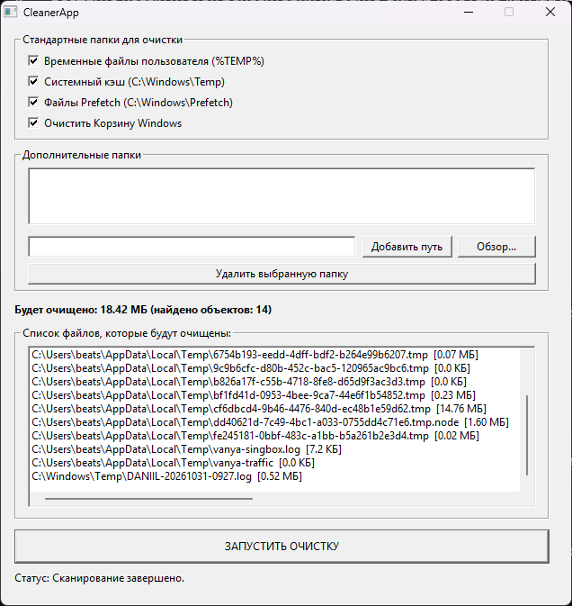

# CleanerApp

Простая утилита для очистки диска Windows от временных файлов, системного кэша и мусора.

## Особенности
- Мгновенный подсчет объема в мегабайтах и вывод списка всех найденных файлов сразу при запуске и переключении опций.
- Очистка `%TEMP%`, `Windows\Temp`, `Prefetch`, Корзины Windows, а также возможность добавлять собственные папки.
- Файлы, используемые системой или открытыми программами в данный момент, пропускаются без сбоев.

## Сборка из исходников

Запустите файл `build_mingw.bat`.

## Лицензия

[MIT](LICENSE)
